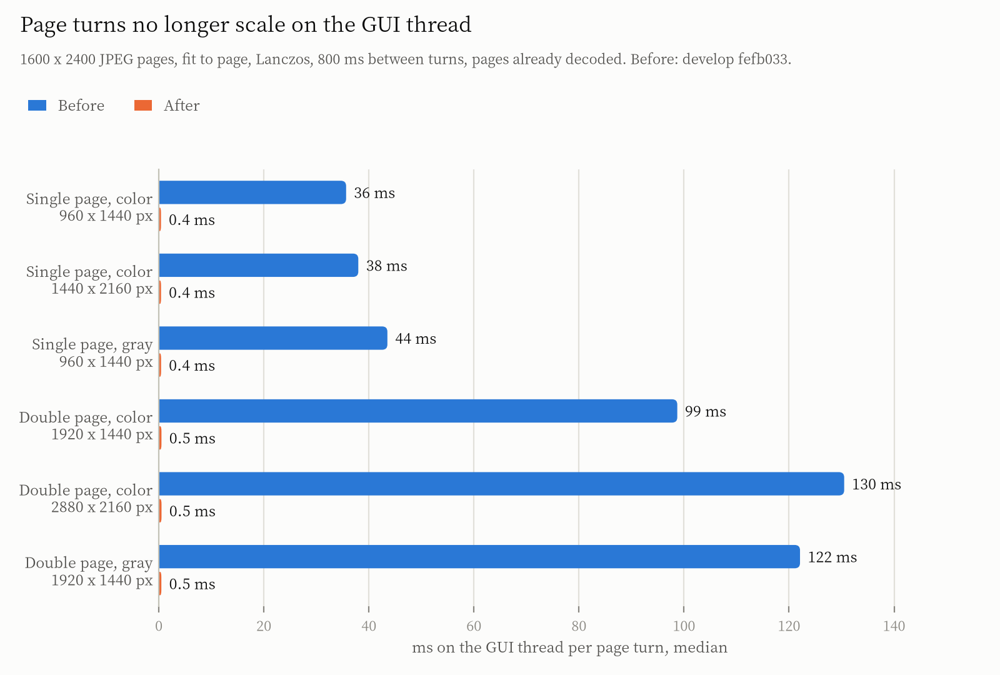
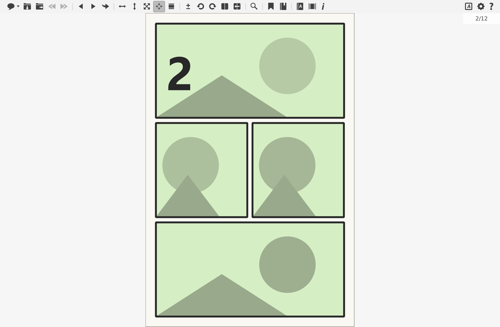
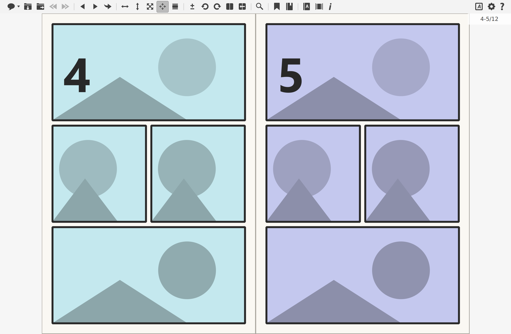
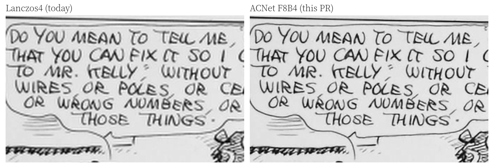
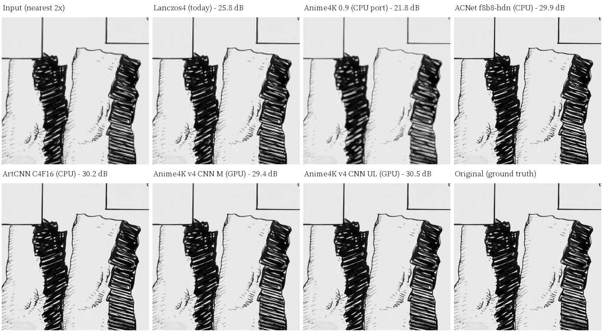

## About this fork

A personal fork of [YACReader](https://github.com/YACReader/yacreader) that changes the comic reader. Each change has a PR. The closed ones are previews that show the change as a diff against upstream `develop`, ready to send upstream if the maintainer wants it. The upstream README starts after the line.

| Change | Kind | PR |
|---|---|---|
| [Choose the page comics open at](#choose-the-page-comics-open-at) | Option | [#3](https://github.com/wonjoonSeol/yacreader/pull/3) |
| [Fit pages to height in continuous scroll](#fit-pages-to-height-in-continuous-scroll) | Option | [#5](https://github.com/wonjoonSeol/yacreader/pull/5) |
| [Go 5 or 10 pages](#go-5-or-10-pages) | Shortcuts | [#4](https://github.com/wonjoonSeol/yacreader/pull/4) |
| [Next file after an unreadable one](#next-file-after-an-unreadable-one) | Bug fix | [#1](https://github.com/wonjoonSeol/yacreader/pull/1) |
| [Comics removed from the Reading list](#comics-removed-from-the-reading-list) | Bug fix | [#2](https://github.com/wonjoonSeol/yacreader/pull/2) |
| [Page turns without scaling](#page-turns-without-scaling) | Speed | [#13](https://github.com/wonjoonSeol/yacreader/pull/13) |
| [Sharper enlarged pages with Anime4K](#sharper-enlarged-pages-with-anime4k) | Option | [#14](https://github.com/wonjoonSeol/yacreader/pull/14) |

**Builds:** open a successful run of [Build](https://github.com/wonjoonSeol/yacreader/actions/workflows/build.yml) and download the `windows-x64-qt6-…` installer or the macOS `.dmg`. They are unsigned, need a GitHub sign-in, and expire after 90 days.

**Screenshots** come from the fork's Linux build with generated sample pages. "Upstream" shots run the same steps on upstream `develop` (268288b).

### Choose the page comics open at

Options > General > **Open comics at**


| Setting | Finished comic | Unfinished comic |
|---|---|---|
| The last page read (default) | last page | last page read |
| The first page if the comic is finished, otherwise the last page read | **first page** | last page read |
| The first page | **first page** | **first page** |

- **Finished:** the reading progress is on the last page, the same rule the library uses to mark a comic as read. Closing a comic on its final double page spread counts too.
- **Where it applies:** comics opened from the library and comics opened as files.
- **Requested on the forum:** [Read comic are opened from the last page](https://www.yacreader.com/forum/support-ios/2096-read-comic-are-opened-from-the-last-page).

### Fit pages to height in continuous scroll

Options > Image adjustment > **Continuous scroll**


| Fit pages to width (default) | Fit pages to height |
|---|---|
|  |  |
| Pages are as wide as the window, so you scroll through each one | Pages are as tall as the window, so you see each one whole |

- A page that would end up wider than the window, such as a double page spread, fits the width instead.
- Comics marked as web comics in the library always fit the width.

### Go 5 or 10 pages


| Keys | Action |
|---|---|
| Shift+← / Shift+→ | Go 5 pages left / right |
| Alt+← / Alt+→ | Go 10 pages left / right |

- **Manga mode:** the directions flip, as they do for ← and →.
- **Double page mode:** the 5 page jump moves 4 pages, so spreads stay paired.
- **Changing the keys:** Options > Shortcuts > Edit shortcuts > Reading. If one of these keys is already bound to another action, that jump starts unassigned.

### Next file after an unreadable one

In a folder with `Comic 1.pdf`, an unreadable `Comic 2.cbz` and `Comic 3.pdf`, going from Comic 1 to the next comic shows this error:


After closing it:

| | Previous / next comic buttons |
|---|---|
| Upstream |  |
| This fork |  |

Upstream disables both buttons and their shortcuts (Ctrl+← and Ctrl+→), so the next file has to be opened by hand. In the fork, Ctrl+→ opens Comic 3.

### Comics removed from the Reading list

Removing a comic from the library's Reading list resets its progress to 0. Opening it again:

| Upstream | This fork |
|---|---|
|  |  |
| Shows 0/10, stays on "Loading...please wait!", then crashes | Opens at page 1 |

### Page turns without scaling

In single and double page mode the pages next to the one you read are scaled to the window in the background, so a page turn shows a page that is ready instead of scaling it first.



| Single page mode | Double page mode |
|---|---|
|  |  |

- **What gets ready:** the page shown, the next two and the previous one, in that order. In double page mode the pages are paired the way the next page turns will pair them.
- **Looks the same:** the pages are pixel for pixel what the reader showed before, in single, double, manga and rotated mode, and in the magnifier.
- **When a page is not ready yet,** for example right after jumping far or when flipping through double pages faster than they decode, it is scaled when it is shown, as before.
- **Memory:** at most 256 MiB of scaled views, always including the one shown. Fitted to the window a 1440 x 2160 view takes about 12 MB, so all four fit; zoomed in far, or fitted to the width of a large screen, the views at the end of that order are left out.
- **Continuous scroll** already scaled its pages in the background and is unchanged.

### Sharper enlarged pages with Anime4K

Options > Image adjustment > Scaling > **Upscale small pages with Anime4K (ACNet)**, off by default, with a **Model** choice: F8B4 (default) or F8B8-HDN.

In single page, double page and continuous scroll mode, a page shown at 1.5 times its own size or more is first shown scaled as usual, then replaced by a sharper one: [Anime4KCPP](https://github.com/TianZerL/Anime4KCPP)'s ACNet, a small neural network for line art, doubles it on the CPU in the background, and Lanczos takes it to the window size. The network sharpens the luma; colour and transparency are scaled with Catmull-Rom. The code is vendored in `third_party/anime4kcpp` (MIT) with the revisions it came from and a patch of the changes made to it.



Quality: the page shrunk to half with a 2x2 box filter, doubled again, and compared with the original (whole page, PSNR / SSIM on luma).

| Method | Krazy Kat page | Synthetic gray page | Synthetic colour page |
|---|---|---|---|
| Lanczos4 (the default scaling) | 25.8 dB / 0.931 | 22.5 / 0.946 | 27.7 / 0.969 |
| **ACNet F8B4 (default model)** | **29.5 / 0.970** | **26.4 / 0.980** | **31.5 / 0.990** |
| ACNet F8B8-HDN | 29.9 / 0.969 | 26.6 / 0.981 | 31.7 / 0.990 |
| Anime4K 0.9, CPU port | 21.8 / 0.888 | 18.1 / 0.892 | 24.0 / 0.957 |
| ArtCNN C4F16, CPU (not included) | 30.2 / 0.973 | 28.2 / 0.987 | 32.6 / 0.992 |
| Anime4K v4 CNN M, GPU shader | 29.4 / 0.966 | 25.9 / 0.979 | 32.0 / 0.989 |
| Anime4K v4 CNN UL, GPU shader | 30.5 / 0.970 | 28.4 / 0.987 | 33.0 / 0.992 |

The Krazy Kat page is George Herriman's of 1922-04-02, public domain ([Wikimedia Commons](https://commons.wikimedia.org/wiki/File:Krazy_Kat_1922-04-02_original.jpg)), in gray at 2482 x 3000. The synthetic pages are generated 2000 x 3000 manga-style pages.

| Hatching | Lettering |
|---|---|
|  |  |

Speed of one 2x upscale of a 1000 x 1500 page, in ms:

| | Gray | Colour |
|---|---|---|
| Lanczos4, one thread (WSL) | 37 | 39 |
| ACNet F8B4, 8 threads (Windows) | 46 | 66 |
| ACNet F8B8-HDN, 8 threads (Windows) | 82 | 99 |
| ACNet F8B4, 1 / 4 / 16 threads (WSL) | 229 / 71 / 43 | 253 / 87 / 61 |
| ACNet F8B8-HDN, 1 / 4 / 16 threads (WSL) | 345 / 132 / 72 | not measured cleanly |

Ryzen 7 5700X3D with the FMA backend, the one Windows x64 builds pick on this CPU. The Windows row is the MSVC build's test; the WSL rows are the best of 5 to 7 runs on a machine shared with other builds, so allow about ±40%. Linux x86_64 builds use the SSE backend, about 1.7 times slower.

- **CPU:** the network runs on one pool of half the CPU's threads, shared by all upscales, with the fastest backend the CPU supports: FMA or AVX on Windows x64, AVX on Intel Macs, NEON on arm64, SSE on Linux x86_64.
- **Memory:** the network works on strips of 256 rows, so its scratch memory stays near 28 MB for a 1600 pixel wide page. A 1600 x 2400 colour page peaks at about 157 MB more than before the upscale, Lanczos4 at 78 MB. That is about 41 bytes per page pixel, so the 4 megapixel limit below keeps an upscale near 165 MB, and each mode upscales one page at a time.
- **When it runs:** only for pages shown at least 1.5 times their own size, on either side, and of at most 4 megapixels (both pages together for a double page), which also leaves out long webtoon strips; both limits are in `image_processing/acnet_upscale.h`. Up to 2x, Lanczos takes the doubled page to its size whatever the scaling method, since Nearest would alias the lines ACNet just sharpened; past 2x the scaling method does. In single and double page mode the page shown goes first, once the pages around it have their plain scale; continuous scroll starts with the visible pages.

---

| Build | Master | Develop |
|---|---|---|
|Code Validation |[](https://dev.azure.com/luisangelsm/YACReader/_build/latest?definitionId=1&branchName=master)|[](https://dev.azure.com/luisangelsm/YACReader/_build/latest?definitionId=1&branchName=develop)|
|Linux | [](https://dev.azure.com/luisangelsm/YACReader/_build/latest?definitionId=1&branchName=master) | [](https://dev.azure.com/luisangelsm/YACReader/_build/latest?definitionId=1&branchName=develop)|
|Windows x86| [](https://dev.azure.com/luisangelsm/YACReader/_build/latest?definitionId=1&branchName=master)|[](https://dev.azure.com/luisangelsm/YACReader/_build/latest?definitionId=1&branchName=develop)|
|Windows x64| [](https://dev.azure.com/luisangelsm/YACReader/_build/latest?definitionId=1&branchName=master)|[](https://dev.azure.com/luisangelsm/YACReader/_build/latest?definitionId=1&branchName=develop)|
|MacOS | [](https://dev.azure.com/luisangelsm/YACReader/_build/latest?definitionId=1&branchName=master) | [](https://dev.azure.com/luisangelsm/YACReader/_build/latest?definitionId=1&branchName=develop)|
|Publish Build||[](https://dev.azure.com/luisangelsm/YACReader/_build/latest?definitionId=1&branchName=develop)|

# YACReader

"Yet another comic reader"

## License
This software has been developed by Luis Ángel San Martín Rodríguez
(luisangelsm@gmail.com) under GPL v3 license
(see [COPYING.txt](./COPYING.txt)).

## Getting YACReader

### Official releases:
[https://github.com/YACReader/yacreader/releases](https://github.com/YACReader/yacreader/releases)

[](https://flathub.org/apps/details/com.yacreader.YACReader)

### As a package:

[](https://repology.org/metapackage/yacreader)

### From OBS build service:

### Building from source:

See [INSTALL.md](./INSTALL.md)

## Contact
- Project home page : www.yacreader.com
- e-mail:
   - info@yacreader.com
   - support@yacreader.com
- Social:
   - Facebook  - http://www.facebook.com/YACReader
   - Twitter   - https://twitter.com/yacreader
   - YouTube   - https://www.youtube.com/user/yacreader
   - Instagram - https://www.instagram.com/yacreader/

If you need help or have any suggestion, please, send me an e-mail.

## Contributing
If you are interested in contributing to the project *the first step should be to contact me* so we can plan together the best approach, you can send an e-mail, joing the [Discord](https://discord.com/invite/dA5xABa85j) server or just open an issue in this repo. For tiny bug fixes it is usually ok to open a PR directly.

Contributions are not restricted to coding; you can help the project by bringing new UI/UX ideas, designing new assets, writing manuals or tutorials, translating the apps, etc. If you are interested in DevOps, YACReader uses Azure Pipelines for CI/CD, any improvements in that area are welcome. Testing pre-releases is also really appreciated.

### AI Usage
If you can't do it yourself please don't open PRs based on ideas developed using AI. If you are a software engineer it's ok to use AI as long as you know what you are doing, understanding and reviewing agent generated code before opening a PR is a must. Code that just works won't be enough to ensure I'll accept your contribution.

#### Dev Setup
YACReader is developed in *C++/Qt* and built with *CMake*. You need a *C++20* compiler and *Qt 6.9+*. In *Windows* I use *Visual Studio 2022* and in *macOS* I use Xcode, but I do all the coding using *QtCreator*.

The repo includes binaries for the dependencies needed for *Windows* (MSVC compiler) and *macOS* (clang). The *7zip* decompression backend source is downloaded automatically by CMake during configuration.

To build:
```
cmake -B build -DCMAKE_BUILD_TYPE=Release
cmake --build build --parallel
```

See [INSTALL.md](./INSTALL.md) for detailed build options.

##### Running and debugging
YACReader needs to find its dependencies at runtime, make sure that *Qt* binaries are in your *PATH* and the third-party binaries are next to the executable. The best way to make sure you have all the third-party binaries in place is to check YACReader installation and copy the binaries in your output folder.

#### Code Format
YACReader uses `clang-format` to ensure a common style and avoid deviances from it. CI checks this and will fail if the correct format is not used. `clang-format` needs to be called recursively in all the folders because some of them have their own `.clang-format` file, mainly to exclude changing the format in third-party libraries which are included in the source code. I recommend configuring your development tools to use `clang-format`, you can try to use it manually, but please, do it always before committing changes. I recommend using QtCreator configured properly, you can find a tutorial [here]( https://www.vikingsoftware.com/using-clang-format-with-qtcreator/).

#### CI/CD
Any PR will be validated through CI, and it will not be merged if CI fails.

#### Pull Requests
The base and target branch for any PR should always be `develop`.

## Donations
YACReader is free but it needs money to keep being alive, so please, if you like YACReader, visit the home page and make a donation.

## Hacktoberfest
If you are interested in YACReader, please contact me so we can discuss your next steps.

## Sponsors 
Free code signing on Windows provided by [SignPath.io](https://signpath.io/), certificate by [SignPath Foundation](https://signpath.org/)
