## About this fork

A personal fork of [YACReader](https://github.com/YACReader/yacreader) with thirteen changes, each on its own branch. Eleven are in the comic reader (YACReader). Rating and favorites works in both apps: the reader's toolbar sets them and YACReaderLibrary saves and shows them. Folders of images as comics is a library change: YACReaderLibrary adds the folders, and the reader opens them through the shared comic code (`FolderComic`). The upstream README starts after the line.

The PR column says where each change stands. A closed preview shows the change as a diff against upstream `develop`, ready to send upstream if the maintainer wants it. Open and draft PRs in the fork are still being worked on. The two bug fixes are also open upstream, and Bicubic comes from an upstream PR that is still open.

| Change | Kind | App | PR |
|---|---|---|---|
| [Choose the page comics open at](#choose-the-page-comics-open-at) | Option | Reader | [#3](https://github.com/wonjoonSeol/yacreader/pull/3) (closed preview) |
| [Fit pages to height in continuous scroll](#fit-pages-to-height-in-continuous-scroll) | Option | Reader | [#5](https://github.com/wonjoonSeol/yacreader/pull/5) (closed preview) |
| [Scaling methods: Bicubic, Lanczos3 and Lanczos2](#scaling-methods) | Option | Reader | [#6](https://github.com/wonjoonSeol/yacreader/pull/6) (open), [#7](https://github.com/wonjoonSeol/yacreader/pull/7) (draft, from upstream [#620](https://github.com/YACReader/yacreader/pull/620)) |
| [Image adjustment menu](#image-adjustment-menu) | Feature | Reader | [#12](https://github.com/wonjoonSeol/yacreader/pull/12) (draft) |
| [Go 5 or 10 pages](#go-5-or-10-pages) | Feature | Reader | [#4](https://github.com/wonjoonSeol/yacreader/pull/4) (closed preview) |
| [Toolbar in full screen](#toolbar-in-full-screen) | Feature | Reader | [#8](https://github.com/wonjoonSeol/yacreader/pull/8) (draft) |
| [Rate and favorite comics while reading](#rate-and-favorite-comics-while-reading) | Feature | Reader and library | [#9](https://github.com/wonjoonSeol/yacreader/pull/9) (draft) |
| [Page number when the page changes](#page-number-when-the-page-changes) | Feature | Reader | [#11](https://github.com/wonjoonSeol/yacreader/pull/11) (draft) |
| [Pages scaled in the background](#pages-scaled-in-the-background) | Feature | Reader | [#13](https://github.com/wonjoonSeol/yacreader/pull/13) (draft) |
| [Next file after an unreadable one](#next-file-after-an-unreadable-one) | Bug fix | Reader | upstream [#630](https://github.com/YACReader/yacreader/pull/630) (open), [#1](https://github.com/wonjoonSeol/yacreader/pull/1) (closed preview) |
| [Comics removed from the Reading list](#comics-removed-from-the-reading-list) | Bug fix | Reader | upstream [#629](https://github.com/YACReader/yacreader/pull/629) (open), [#2](https://github.com/wonjoonSeol/yacreader/pull/2) (closed preview) |
| [Status messages cut off at both ends](#status-messages-cut-off-at-both-ends) | Bug fix | Reader | none yet |
| [Folders of images as comics](#folders-of-images-as-comics) | Feature | Library | [#10](https://github.com/wonjoonSeol/yacreader/pull/10) (draft) |

**Builds:** open a successful run of [Build](https://github.com/wonjoonSeol/yacreader/actions/workflows/build.yml) and download the `windows-x64-qt6-…` installer or the macOS `.dmg`. They are unsigned, need a GitHub sign-in, and expire after 90 days.

**Screenshots** come from the fork's Linux build with generated sample pages. "Upstream" shots run the same steps on upstream `develop` (268288b). Each change's screenshots were taken on its own branch, without the other changes, so for example the full screen and folder comic shots have no heart and stars on the toolbar, and the image adjustment menu lists only three scaling methods.

### Choose the page comics open at

Options > General > **Open comics at**

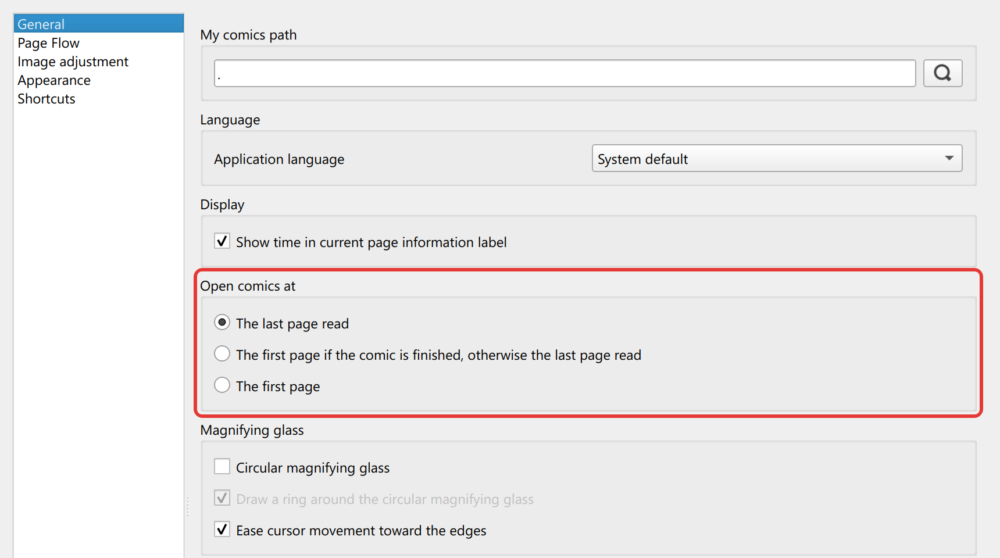

| Setting | Finished comic | Unfinished comic |
|---|---|---|
| The last page read (default) | last page | last page read |
| The first page if the comic is finished, otherwise the last page read | **first page** | last page read |
| The first page | **first page** | **first page** |

- **Finished:** the reading progress is on the last page, the same rule the library uses to mark a comic as read. Closing a comic on its final double page spread counts too.
- **Where it applies:** comics opened from the library and comics opened as files.
- **Requested on the forum:** [Read comic are opened from the last page](https://www.yacreader.com/forum/support-ios/2096-read-comic-are-opened-from-the-last-page).

### Fit pages to height in continuous scroll

Options > Image adjustment > **Continuous scroll**

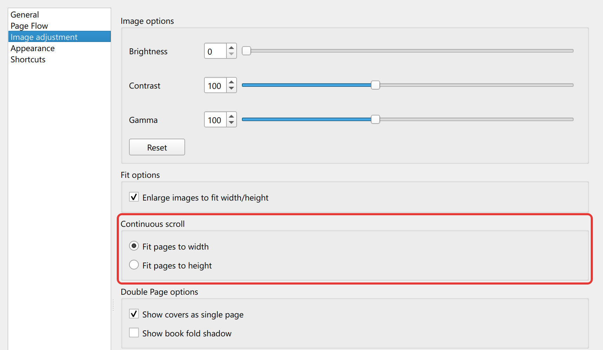

| Fit pages to width (default) | Fit pages to height |
|---|---|
| 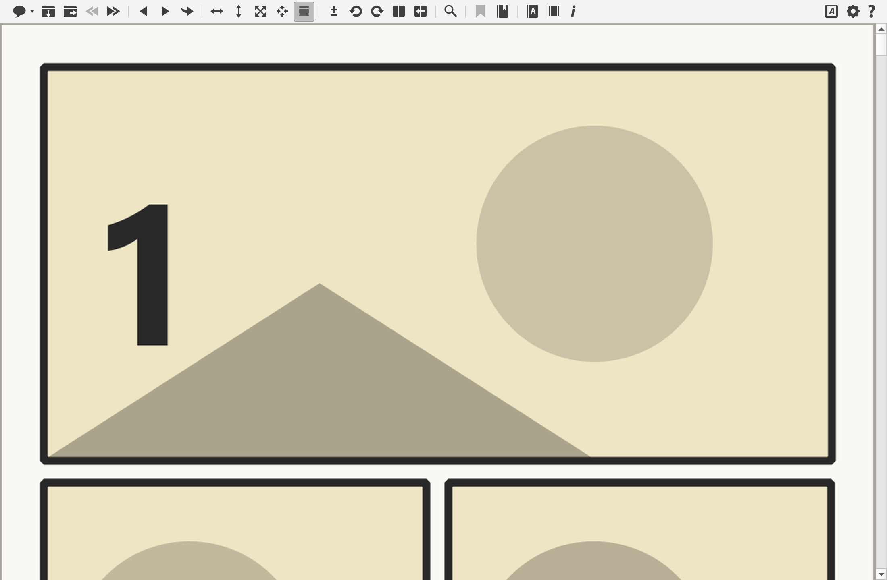 | 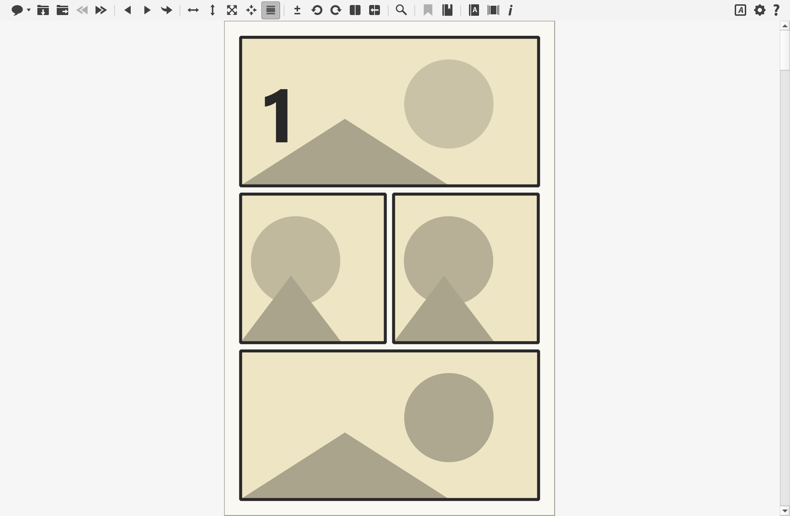 |
| Pages are as wide as the window, so you scroll through each one | Pages are as tall as the window, so you see each one whole |

- A page that would end up wider than the window, such as a double page spread, fits the width instead.
- Comics marked as web comics in the library always fit the width.

### Scaling methods

Options > Image adjustment > Scaling > **Scaling method**, also in the [image adjustment menu](#image-adjustment-menu)

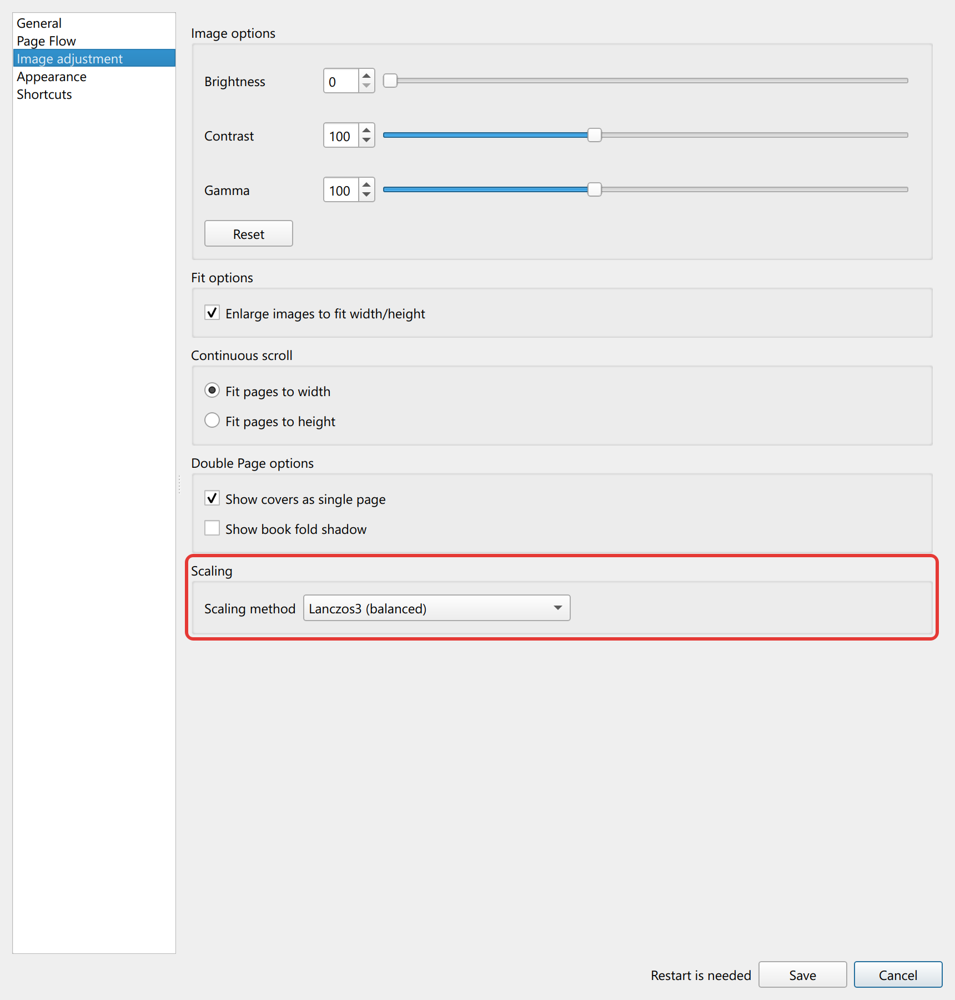

| Method | What you get | Stored as |
|---|---|---|
| Nearest, Bilinear | Unchanged from upstream | `0`, `1` |
| Bicubic | A Catmull-Rom cubic (B = 0, C = 1/2) from upstream [#620](https://github.com/YACReader/yacreader/pull/620) by [dichongwu](https://github.com/dichongwu). Less ringing than the Lanczos methods | `3`, the same value as in #620 |
| Lanczos4 (default) | Upstream's Lanczos under a new name, 4 lobes. The most fine detail and the most halos around lines | `2`, as before |
| Lanczos3 | 3 lobes, in between | `4` |
| Lanczos2 | 2 lobes. The fewest halos of the three, a little less fine detail | `5` |

The same line art enlarged 3x, with the boxed part shown 3x larger again below it. The light bands next to the strokes are the halos:

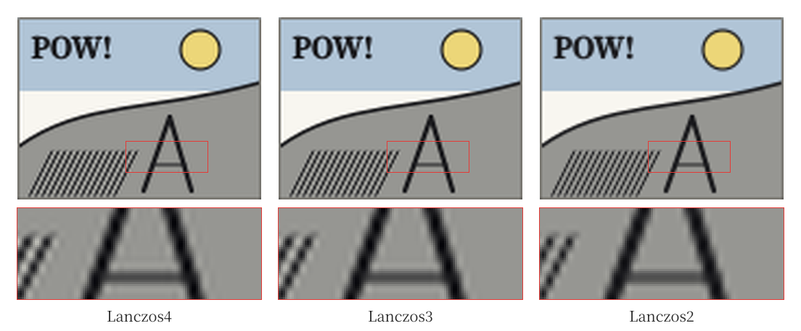

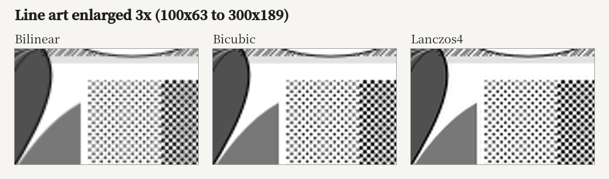

Measured on a grey edge (64 to 192) and on fine stripes, both enlarged 4x:

| | Bilinear | Bicubic | Lanczos4 | Lanczos3 | Lanczos2 |
|---|---|---|---|---|---|
| Overshoot past the edge (grey levels) | 0 | 9 | 16 | 15 | 10 |
| Pixels from the edge that change | 2 | 6 | 13 | 9 | 6 |
| Edge rise from 10% to 90% (px) | 3.4 | not measured | 3.0 | 3.0 | 3.0 |
| Contrast kept on stripes with a 3 px period | 77% | not measured | 98% | 96% | 90% |

- **Edges** are equally steep with the three Lanczos methods. The difference is in the halos and the finest detail.
- **Shrinking** 4x, the overshoot is at most 2 grey levels with any of the Lanczos methods.
- **Bicubic in the fork** averages the stored sRGB values like the other methods. #620 averages in linear light, which made shrunk line art and screentones lighter than with Bilinear or Lanczos4 and deepened the dark halo beside enlarged edges.
- **Speed:** shrinking a 1600x2400 page to 1067x1600 takes about 40 ms with Bicubic, split over up to 4 threads, where Lanczos4 takes about 30 ms on one.
- **Settings:** a stored value the fork does not know falls back to Lanczos4.
- **Requested upstream:** [Algorithms for image scaling](https://github.com/YACReader/yacreader/issues/529) asks for Lanczos3.

### Image adjustment menu

Right-click the page > **Image adjustment**, or click the arrow next to the Options button on the toolbar. It changes the options of Options > Image adjustment while you read:

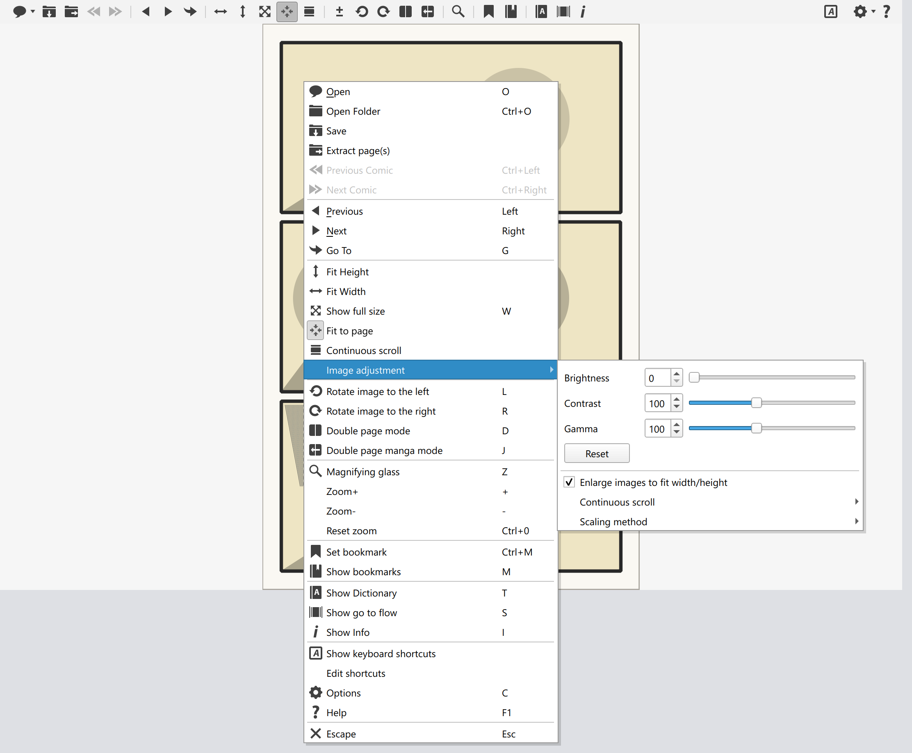

| In the menu | Options > Image adjustment |
|---|---|
| Brightness, Contrast, Gamma, Reset | Image options |
| Enlarge images to fit width/height | Fit options |
| Continuous scroll > Fit pages to width / height | Continuous scroll |
| Scaling method > the [scaling methods](#scaling-methods) of Options | Scaling |

| Moving a slider | The arrow next to Options |
|---|---|
| 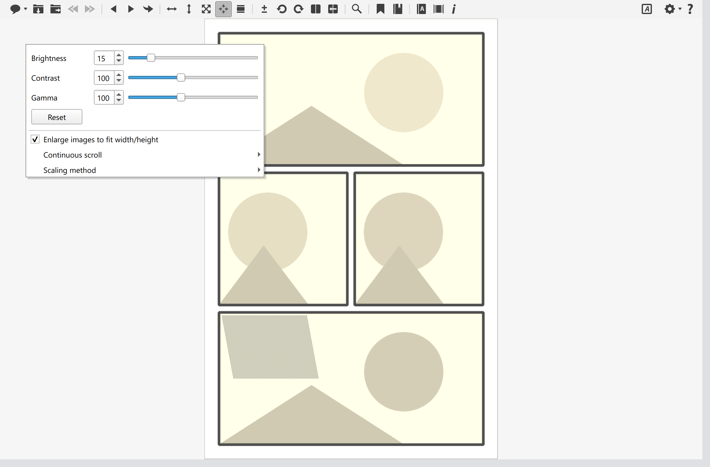 | 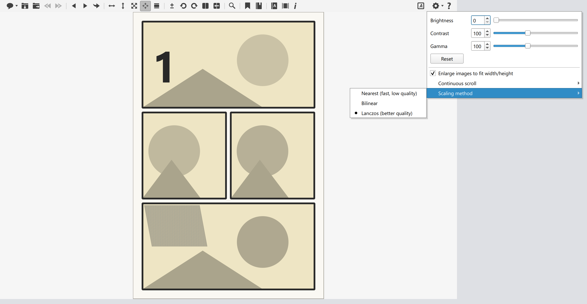 |
| The menu stays open and the page changes when you let go | Works in every mouse mode |

- **Same settings as Options:** a change in the menu shows in Options, and a change in Options shows the next time the menu opens.
- **Right-click** opens the menu unless Options > General > Mouse mode is "Use the Left/Right buttons to turn pages", where the right button turns the page. The arrow next to Options works in every mode.
- **macOS:** right-click only. The native toolbar has no arrow.

### Go 5 or 10 pages

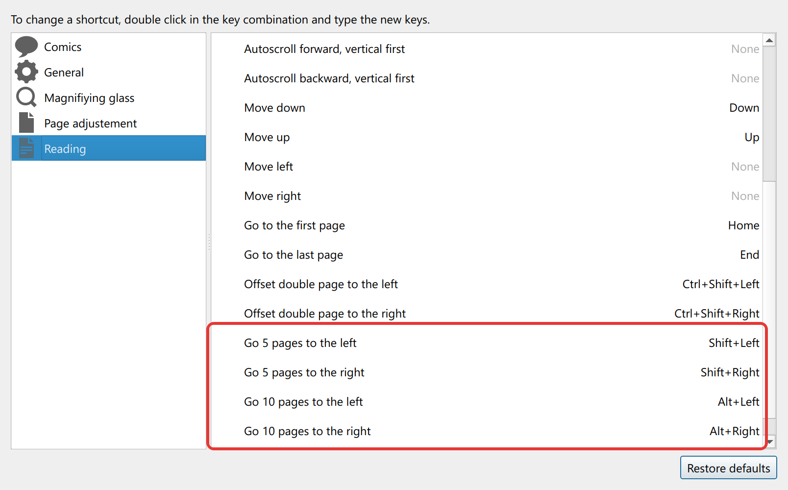

| Keys | Action |
|---|---|
| Shift+← / Shift+→ | Go 5 pages left / right |
| Alt+← / Alt+→ | Go 10 pages left / right |

- **Manga mode:** the directions flip, as they do for ← and →.
- **Double page mode:** the 5 page jump moves 4 pages, so spreads stay paired.
- **Changing the keys:** Options > Shortcuts > Edit shortcuts > Reading. If you already gave one of these keys to another action, that jump starts unassigned.

### Toolbar in full screen

Full screen (F) has no title bar and hides the toolbar. Move the mouse to the top of the screen to show the toolbar over the page, where it covers the page number in the top right corner. It hides again when the mouse moves back down to the page or leaves the screen.

| Full screen | Mouse at the top of the screen |
|---|---|
| 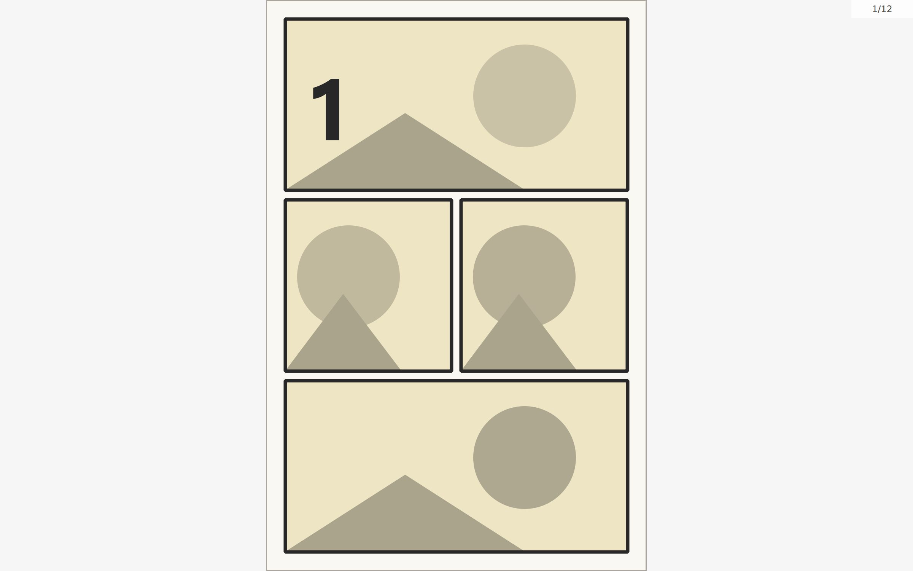 | 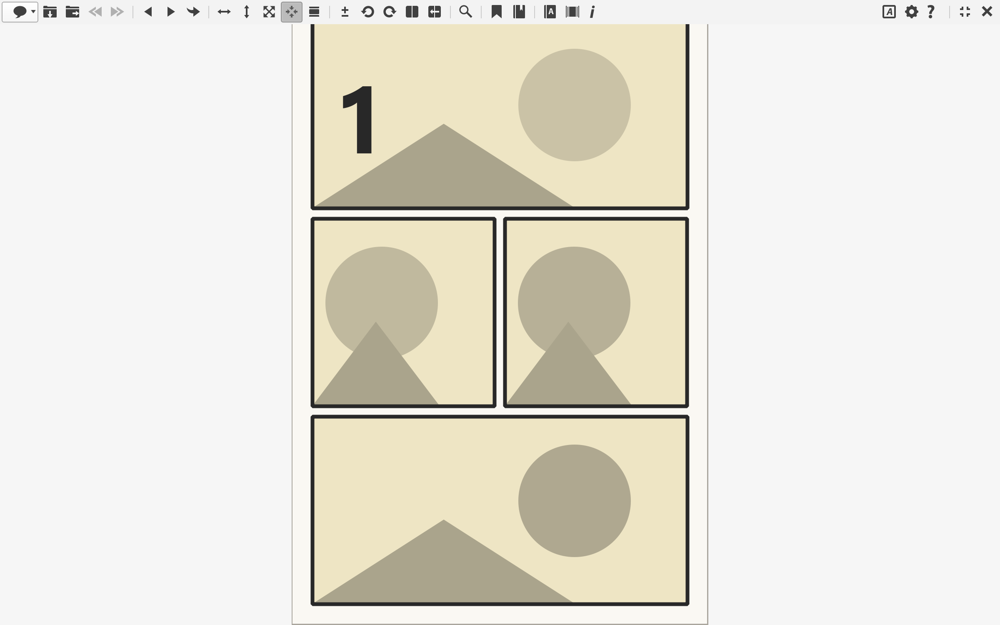 |


- **Exit fullscreen and close:** two buttons at the right end of the toolbar, shown only in full screen.
- **The page stays still:** the toolbar covers the top of the page instead of pushing it down.
- **Not while** the magnifying glass is on or a mouse button is held, so dragging a page up to the top does not open it.
- **macOS:** unchanged. In full screen macOS shows its own menu bar and window buttons at the top of the screen.

### Rate and favorite comics while reading

A comic opened from the library gets a favorite button and five stars on the toolbar. They show the comic's rating and whether it is in the library's Favorites, and a change is saved to the library right away. If the library cannot save it, the button goes back and a message says so.

| | Favorite and rating buttons |
|---|---|
| Comic from the library | 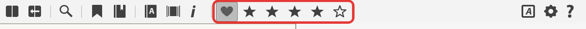 |
| File opened directly | 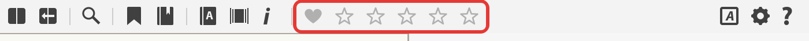 |

The library, open at the same time, shows the change:

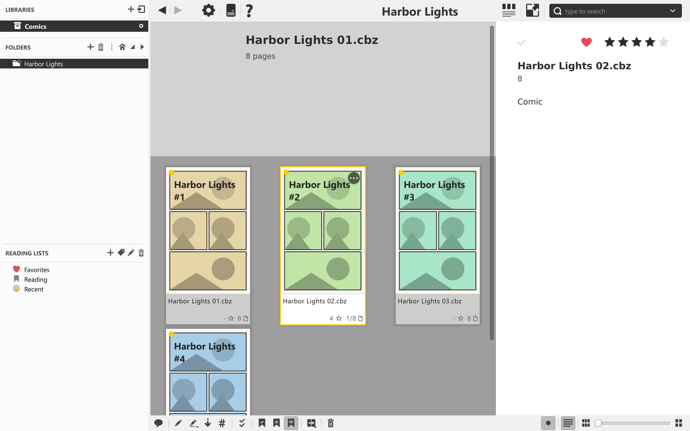

- **Rating:** a star sets the rating from 1 to 5, and the current one clears it. Keys 1 to 5 do the same.
- **Favorite:** the heart adds the comic to the library's Favorites or removes it. An open Favorites list updates too.
- **Keys:** Options > Shortcuts > Edit shortcuts > Comics. The heart has no key until you set one. If you already gave 1 to 5 to other actions, those ratings start unassigned.

### Page number when the page changes

Turning a page shows the page number in the top left corner for a moment, then it fades out. Options > General > Display > **Briefly show the page number when the page changes**, on by default.

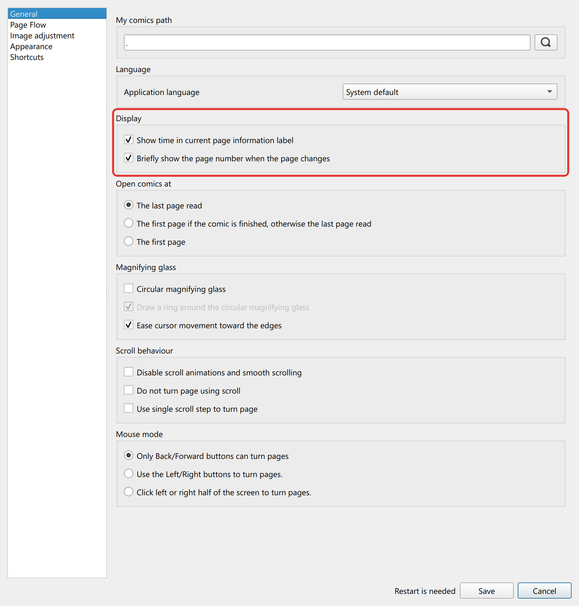

| Single page | Double page |
|---|---|
| 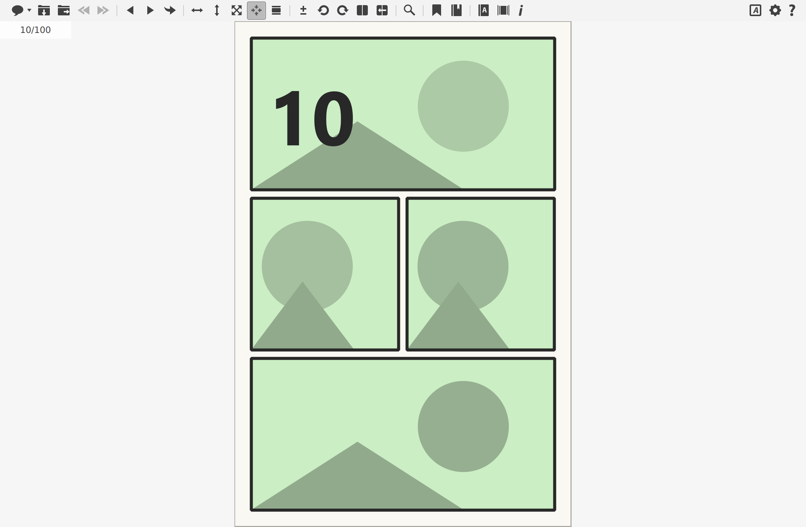 | 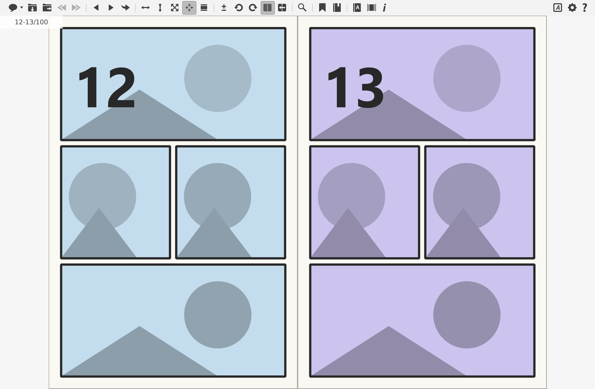 |

- **When:** next and previous page, Go 5 or 10 pages, Go to page, the page flow, bookmarks, first and last page, opening a comic, and scrolling onto another page in continuous scroll. It stays hidden when the page doesn't change, such as Next on the last page.
- **Double page mode:** a spread shows both pages, such as 12-13/100. In manga mode they read right to left, 13-12/100, as in the page information label.
- **Show Info (I):** while the page information label is on, the counter stays hidden because the label already shows the page.
- **Look:** the colors of the page information label in the current theme. It stays for 1 second and fades out in 0.4 seconds; on macOS it hides without fading.

### Pages scaled in the background

In single and double page mode, a page turn used to scale the page to the window before showing it, and in double page mode it first drew both pages together at full size. Now the current view, the next two and the previous one are scaled in the background, and a page turn shows the prepared image. The pages look the same as before.

Time a page turn kept the reader busy, median, with 1600x2400 JPEG pages, Fit to page and Lanczos4 (Linux build):

| View | Before | Now |
|---|---|---|
| Single page, 960 x 1440 px | 35.7 ms | 0.41 ms |
| Double page, 1920 x 1440 px | 98.7 ms | 0.50 ms |

- **When it scales again:** after a change of window size, zoom, fit mode or scaling method (from Options or the image adjustment menu), and after rotating, a filter change or opening another comic.
- **Flipping fast:** at a page every 150 ms, single page mode still had the page ready on 12 of 13 turns. Double page mode fell behind after three spreads and then scaled on the turn, as before.
- **Continuous scroll** already scaled ahead and is unchanged.

### Next file after an unreadable one

In a folder with `Comic 1.pdf`, an unreadable `Comic 2.cbz` and `Comic 3.pdf`, going from Comic 1 to the next comic shows this error:

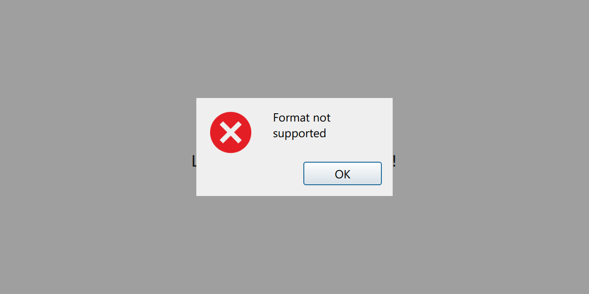

After closing it:

| | Previous / next comic buttons |
|---|---|
| Upstream | 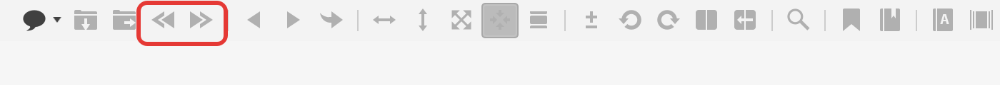 |
| This fork | 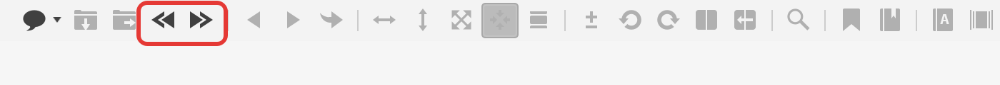 |

Upstream disables both buttons and their shortcuts (Ctrl+← and Ctrl+→), so the next file has to be opened by hand. In the fork, Ctrl+→ opens Comic 3.

### Comics removed from the Reading list

Removing a comic from the library's Reading list resets its progress to 0. Opening it again:

| Upstream | This fork |
|---|---|
| 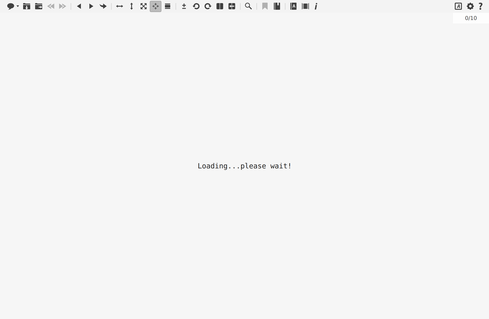 | 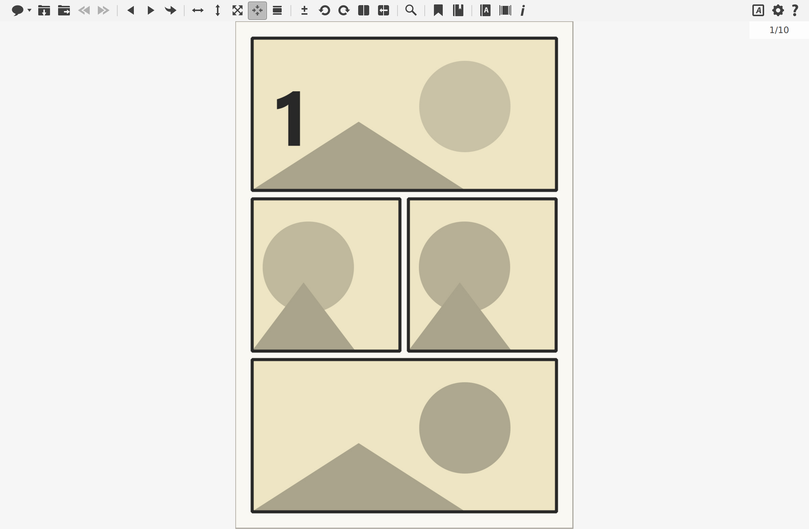 |
| Shows 0/10, stays on "Loading...please wait!", then crashes | Opens at page 1 |

### Status messages cut off at both ends

The reader's status messages, such as "Press 'O' to open comic.", "Loading...please wait!" and "Page not available!", share one label, which kept the size of the first message it showed. A longer message was then cut off on both sides, because it is centred: in Korean the loading message lost its first and last characters, and Turkish was affected too. The label now fits each new message.

### Folders of images as comics

YACReaderLibrary reads a folder of images as one comic, like a `.cbz`, without converting anything. Upstream leaves such folders out of the library ([#164](https://github.com/YACReader/yacreader/issues/164)).

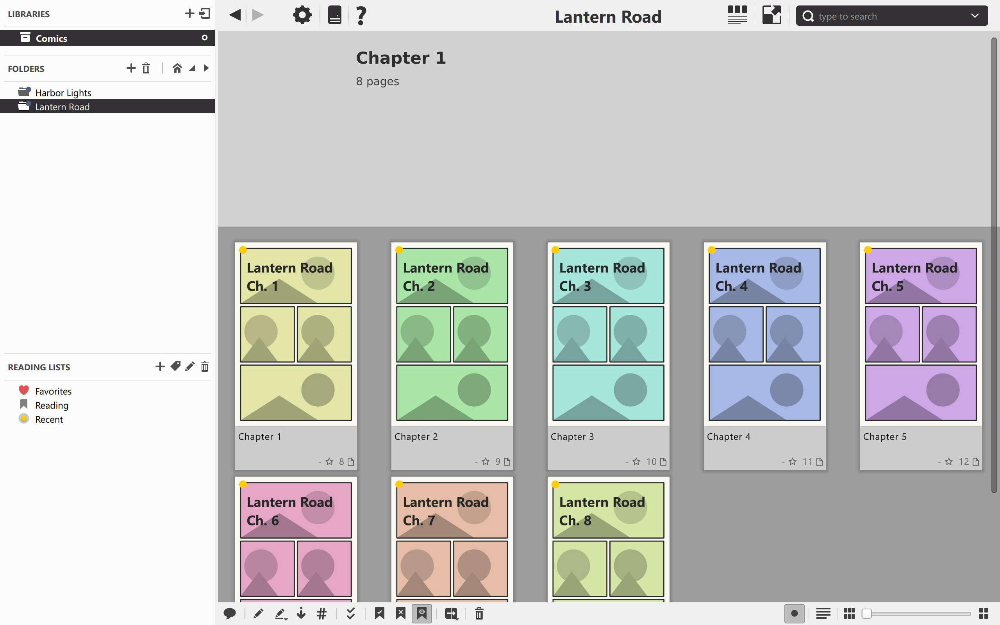

- **What counts as a comic:** a folder with at least one image directly inside, and no subfolders or comic files (`.cbz`, `.cbr`, `.pdf` and the like). Other files, such as `ComicInfo.xml` or a text file, do not matter. A folder whose name starts with a dot is never a comic.
- **Layouts:** in `Series/Chapter 1/001.jpg`, Series is a folder and Chapter 1 is a comic. A folder with images and subfolders stays a folder, and its own images are left out.
- **Like an archive:** cover, page count, `ComicInfo.xml` import when it is turned on, reading progress, and library updates when pages are added or removed.

| Next to archives | Opened from the library |
|---|---|
| 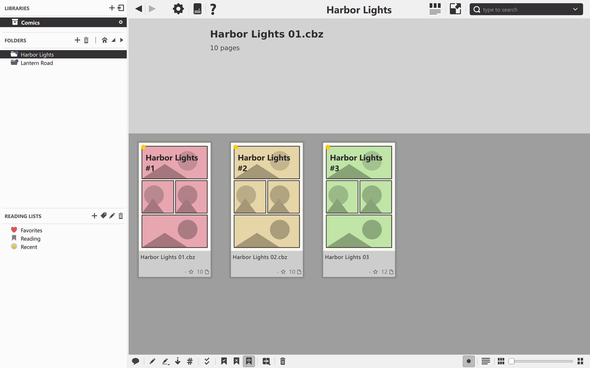 | 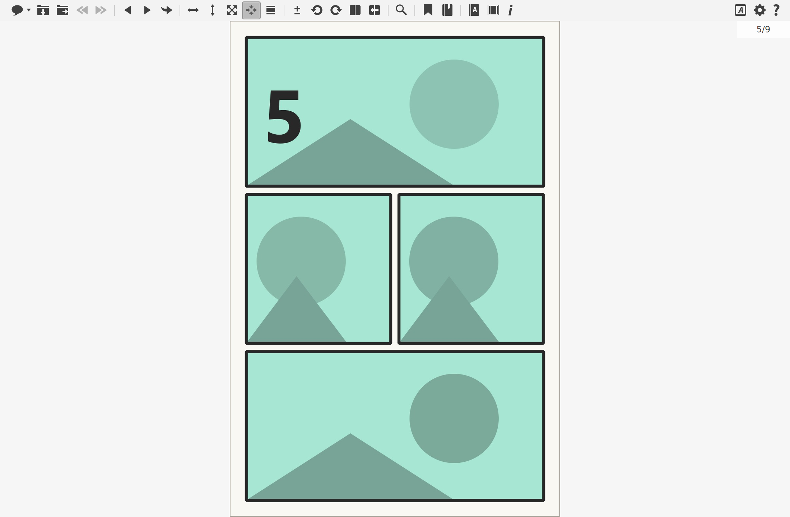 |
| `Harbor Lights 03` is a folder, the other two are `.cbz` files | Opens at the page where reading stopped |

- **Deleting:** folder comics are kept unless **Also delete the image folders** is checked. Checked, they go to the trash. If the trash refuses a folder, YACReaderLibrary asks before deleting it permanently.

  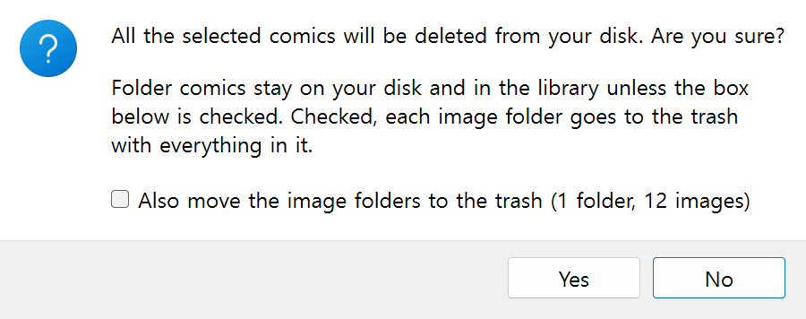

- **Library updates:** a comic or folder that sorts after a new one by number, such as Chapter 10 after a new Chapter 3, is no longer removed and added again, so it keeps its reading lists and labels. This applies to archives too.
- **Not covered:** dragging a folder of images onto the library still imports only comic files, and Organize files does not move a folder comic to another drive.

---

| Build | Master | Develop |
|---|---|---|
|Code Validation |[](https://dev.azure.com/luisangelsm/YACReader/_build/latest?definitionId=1&branchName=master)|[](https://dev.azure.com/luisangelsm/YACReader/_build/latest?definitionId=1&branchName=develop)|
|Linux | [](https://dev.azure.com/luisangelsm/YACReader/_build/latest?definitionId=1&branchName=master) | [](https://dev.azure.com/luisangelsm/YACReader/_build/latest?definitionId=1&branchName=develop)|
|Windows x86| [](https://dev.azure.com/luisangelsm/YACReader/_build/latest?definitionId=1&branchName=master)|[](https://dev.azure.com/luisangelsm/YACReader/_build/latest?definitionId=1&branchName=develop)|
|Windows x64| [](https://dev.azure.com/luisangelsm/YACReader/_build/latest?definitionId=1&branchName=master)|[](https://dev.azure.com/luisangelsm/YACReader/_build/latest?definitionId=1&branchName=develop)|
|MacOS | [](https://dev.azure.com/luisangelsm/YACReader/_build/latest?definitionId=1&branchName=master) | [](https://dev.azure.com/luisangelsm/YACReader/_build/latest?definitionId=1&branchName=develop)|
|Publish Build||[](https://dev.azure.com/luisangelsm/YACReader/_build/latest?definitionId=1&branchName=develop)|

# YACReader

"Yet another comic reader"

## License
This software has been developed by Luis Ángel San Martín Rodríguez
(luisangelsm@gmail.com) under GPL v3 license
(see [COPYING.txt](./COPYING.txt)).

## Getting YACReader

### Official releases:
[https://github.com/YACReader/yacreader/releases](https://github.com/YACReader/yacreader/releases)

[](https://flathub.org/apps/details/com.yacreader.YACReader)

### As a package:

[](https://repology.org/metapackage/yacreader)

### From OBS build service:

### Building from source:

See [INSTALL.md](./INSTALL.md)

## Contact
- Project home page : www.yacreader.com
- e-mail:
   - info@yacreader.com
   - support@yacreader.com
- Social:
   - Facebook  - http://www.facebook.com/YACReader
   - Twitter   - https://twitter.com/yacreader
   - YouTube   - https://www.youtube.com/user/yacreader
   - Instagram - https://www.instagram.com/yacreader/

If you need help or have any suggestion, please, send me an e-mail.

## Contributing
If you are interested in contributing to the project *the first step should be to contact me* so we can plan together the best approach, you can send an e-mail, joing the [Discord](https://discord.com/invite/dA5xABa85j) server or just open an issue in this repo. For tiny bug fixes it is usually ok to open a PR directly.

Contributions are not restricted to coding; you can help the project by bringing new UI/UX ideas, designing new assets, writing manuals or tutorials, translating the apps, etc. If you are interested in DevOps, YACReader uses Azure Pipelines for CI/CD, any improvements in that area are welcome. Testing pre-releases is also really appreciated.

### AI Usage
If you can't do it yourself please don't open PRs based on ideas developed using AI. If you are a software engineer it's ok to use AI as long as you know what you are doing, understanding and reviewing agent generated code before opening a PR is a must. Code that just works won't be enough to ensure I'll accept your contribution.

#### Dev Setup
YACReader is developed in *C++/Qt* and built with *CMake*. You need a *C++20* compiler and *Qt 6.9+*. In *Windows* I use *Visual Studio 2022* and in *macOS* I use Xcode, but I do all the coding using *QtCreator*.

The repo includes binaries for the dependencies needed for *Windows* (MSVC compiler) and *macOS* (clang). The *7zip* decompression backend source is downloaded automatically by CMake during configuration.

To build:
```
cmake -B build -DCMAKE_BUILD_TYPE=Release
cmake --build build --parallel
```

See [INSTALL.md](./INSTALL.md) for detailed build options.

##### Running and debugging
YACReader needs to find its dependencies at runtime, make sure that *Qt* binaries are in your *PATH* and the third-party binaries are next to the executable. The best way to make sure you have all the third-party binaries in place is to check YACReader installation and copy the binaries in your output folder.

#### Code Format
YACReader uses `clang-format` to ensure a common style and avoid deviances from it. CI checks this and will fail if the correct format is not used. `clang-format` needs to be called recursively in all the folders because some of them have their own `.clang-format` file, mainly to exclude changing the format in third-party libraries which are included in the source code. I recommend configuring your development tools to use `clang-format`, you can try to use it manually, but please, do it always before committing changes. I recommend using QtCreator configured properly, you can find a tutorial [here]( https://www.vikingsoftware.com/using-clang-format-with-qtcreator/).

#### CI/CD
Any PR will be validated through CI, and it will not be merged if CI fails.

#### Pull Requests
The base and target branch for any PR should always be `develop`.

## Donations
YACReader is free but it needs money to keep being alive, so please, if you like YACReader, visit the home page and make a donation.

## Hacktoberfest
If you are interested in YACReader, please contact me so we can discuss your next steps.

## Sponsors 
Free code signing on Windows provided by [SignPath.io](https://signpath.io/), certificate by [SignPath Foundation](https://signpath.org/)
