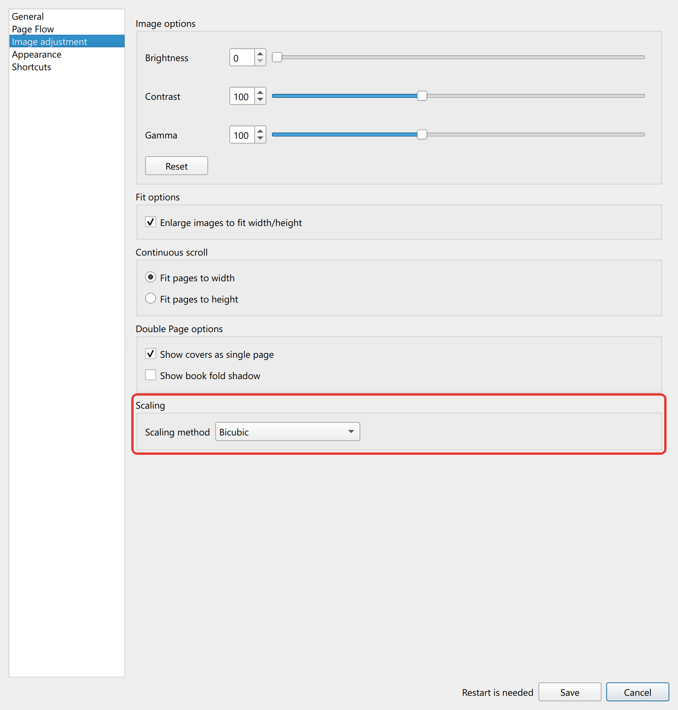

## About this fork

A personal fork of [YACReader](https://github.com/YACReader/yacreader) with seven changes to the comic reader. Each one has a PR. Bicubic scaling comes from an upstream PR that is still open; the closed ones are previews that show the change as a diff against upstream `develop`, ready to send upstream if the maintainer wants it. The upstream README starts after the line.

| Change | Kind | PR |
|---|---|---|
| [Choose the page comics open at](#choose-the-page-comics-open-at) | Option | [#3](https://github.com/wonjoonSeol/yacreader/pull/3) |
| [Fit pages to height in continuous scroll](#fit-pages-to-height-in-continuous-scroll) | Option | [#5](https://github.com/wonjoonSeol/yacreader/pull/5) |
| [Bicubic scaling](#bicubic-scaling) | Option | [#7](https://github.com/wonjoonSeol/yacreader/pull/7), from upstream [#620](https://github.com/YACReader/yacreader/pull/620) |
| [Go 5 or 10 pages](#go-5-or-10-pages) | Shortcuts | [#4](https://github.com/wonjoonSeol/yacreader/pull/4) |
| [Next file after an unreadable one](#next-file-after-an-unreadable-one) | Bug fix | [#1](https://github.com/wonjoonSeol/yacreader/pull/1) |
| [Comics removed from the Reading list](#comics-removed-from-the-reading-list) | Bug fix | [#2](https://github.com/wonjoonSeol/yacreader/pull/2) |
| [Lanczos3 and Lanczos2 scaling](#lanczos3-and-lanczos2-scaling) | Option | [#6](https://github.com/wonjoonSeol/yacreader/pull/6) |

**Builds:** open a successful run of [Build](https://github.com/wonjoonSeol/yacreader/actions/workflows/build.yml) and download the `windows-x64-qt6-…` installer or the macOS `.dmg`. They are unsigned, need a GitHub sign-in, and expire after 90 days.

**Screenshots** come from the fork's Linux build with generated sample pages. "Upstream" shots run the same steps on upstream `develop` (268288b).

### Choose the page comics open at

Options > General > **Open comics at**


| Setting | Finished comic | Unfinished comic |
|---|---|---|
| The last page read (default) | last page | last page read |
| The first page if the comic is finished, otherwise the last page read | **first page** | last page read |
| The first page | **first page** | **first page** |

- **Finished:** the reading progress is on the last page, the same rule the library uses to mark a comic as read. Closing a comic on its final double page spread counts too.
- **Where it applies:** comics opened from the library and comics opened as files.
- **Requested on the forum:** [Read comic are opened from the last page](https://www.yacreader.com/forum/support-ios/2096-read-comic-are-opened-from-the-last-page).

### Fit pages to height in continuous scroll

Options > Image adjustment > **Continuous scroll**


| Fit pages to width (default) | Fit pages to height |
|---|---|
|  |  |
| Pages are as wide as the window, so you scroll through each one | Pages are as tall as the window, so you see each one whole |

- A page that would end up wider than the window, such as a double page spread, fits the width instead.
- Comics marked as web comics in the library always fit the width.

### Bicubic scaling

Options > Image adjustment > Scaling > **Scaling method: Bicubic**




- **What it is:** a Catmull-Rom cubic (B = 0, C = 1/2) from upstream [#620](https://github.com/YACReader/yacreader/pull/620) by [dichongwu](https://github.com/dichongwu). It rings less than Lanczos4: a grey 64/192 edge enlarged 4x goes 9 grey levels past either side within 6 px of the edge, against 16 levels and 13 px with Lanczos4 (Bilinear: none, 2 px).
- **Changed in the fork:** it averages the stored sRGB values like the other methods. #620 averages in linear light, which made shrunk line art and screentones lighter than with Bilinear or Lanczos4 and deepened the dark halo beside enlarged edges.
- **Speed:** shrinking a 1600x2400 page to 1067x1600 takes about 40 ms split over up to 4 threads, where Lanczos4 takes about 30 ms on one.
- **Setting:** stored as `3`, the same value as in #620.

### Go 5 or 10 pages


| Keys | Action |
|---|---|
| Shift+← / Shift+→ | Go 5 pages left / right |
| Alt+← / Alt+→ | Go 10 pages left / right |

- **Manga mode:** the directions flip, as they do for ← and →.
- **Double page mode:** the 5 page jump moves 4 pages, so spreads stay paired.
- **Changing the keys:** Options > Shortcuts > Edit shortcuts > Reading. If one of these keys is already bound to another action, that jump starts unassigned.

### Next file after an unreadable one

In a folder with `Comic 1.pdf`, an unreadable `Comic 2.cbz` and `Comic 3.pdf`, going from Comic 1 to the next comic shows this error:


After closing it:

| | Previous / next comic buttons |
|---|---|
| Upstream |  |
| This fork |  |

Upstream disables both buttons and their shortcuts (Ctrl+← and Ctrl+→), so the next file has to be opened by hand. In the fork, Ctrl+→ opens Comic 3.

### Comics removed from the Reading list

Removing a comic from the library's Reading list resets its progress to 0. Opening it again:

| Upstream | This fork |
|---|---|
|  |  |
| Shows 0/10, stays on "Loading...please wait!", then crashes | Opens at page 1 |

### Lanczos3 and Lanczos2 scaling

Options > Image adjustment > **Scaling** > Scaling method


| Method | Lobes | What you get |
|---|---|---|
| Lanczos4 (default) | 4 | Upstream's Lanczos under a new name. The most fine detail and the most halos around lines |
| Lanczos3 | 3 | In between |
| Lanczos2 | 2 | The fewest halos, a little less fine detail |

The same line art enlarged 3x, with the boxed part shown 3x larger again below it. The light bands next to the strokes are the halos:


Measured on a grey edge (64 to 192) and on fine stripes, both enlarged 4x:

| | Lanczos4 | Lanczos3 | Lanczos2 | Bilinear |
|---|---|---|---|---|
| Overshoot past the edge (grey levels) | 16 | 15 | 10 | 0 |
| Pixels from the edge that change | 13 | 9 | 6 | 2 |
| Edge rise from 10% to 90% (px) | 3.0 | 3.0 | 3.0 | 3.4 |
| Contrast kept on stripes with a 3 px period | 98% | 96% | 90% | 77% |

- **Edges** are equally steep with all three. The difference is in the halos and the finest detail.
- **Shrinking** 4x, the overshoot is at most 2 grey levels with any of them.
- **Settings:** Lanczos3 and Lanczos2 are stored as 4 and 5. Nothing uses 3, so it stays free for the Bicubic method that the open upstream PR [#620](https://github.com/YACReader/yacreader/pull/620) stores as 3. A stored value the fork does not know, 3 included, falls back to Lanczos4.
- **Requested upstream:** [Algorithms for image scaling](https://github.com/YACReader/yacreader/issues/529) asks for Lanczos3.

---

| Build | Master | Develop |
|---|---|---|
|Code Validation |[](https://dev.azure.com/luisangelsm/YACReader/_build/latest?definitionId=1&branchName=master)|[](https://dev.azure.com/luisangelsm/YACReader/_build/latest?definitionId=1&branchName=develop)|
|Linux | [](https://dev.azure.com/luisangelsm/YACReader/_build/latest?definitionId=1&branchName=master) | [](https://dev.azure.com/luisangelsm/YACReader/_build/latest?definitionId=1&branchName=develop)|
|Windows x86| [](https://dev.azure.com/luisangelsm/YACReader/_build/latest?definitionId=1&branchName=master)|[](https://dev.azure.com/luisangelsm/YACReader/_build/latest?definitionId=1&branchName=develop)|
|Windows x64| [](https://dev.azure.com/luisangelsm/YACReader/_build/latest?definitionId=1&branchName=master)|[](https://dev.azure.com/luisangelsm/YACReader/_build/latest?definitionId=1&branchName=develop)|
|MacOS | [](https://dev.azure.com/luisangelsm/YACReader/_build/latest?definitionId=1&branchName=master) | [](https://dev.azure.com/luisangelsm/YACReader/_build/latest?definitionId=1&branchName=develop)|
|Publish Build||[](https://dev.azure.com/luisangelsm/YACReader/_build/latest?definitionId=1&branchName=develop)|

# YACReader

"Yet another comic reader"

## License
This software has been developed by Luis Ángel San Martín Rodríguez
(luisangelsm@gmail.com) under GPL v3 license
(see [COPYING.txt](./COPYING.txt)).

## Getting YACReader

### Official releases:
[https://github.com/YACReader/yacreader/releases](https://github.com/YACReader/yacreader/releases)

[](https://flathub.org/apps/details/com.yacreader.YACReader)

### As a package:

[](https://repology.org/metapackage/yacreader)

### From OBS build service:

### Building from source:

See [INSTALL.md](./INSTALL.md)

## Contact
- Project home page : www.yacreader.com
- e-mail:
   - info@yacreader.com
   - support@yacreader.com
- Social:
   - Facebook  - http://www.facebook.com/YACReader
   - Twitter   - https://twitter.com/yacreader
   - YouTube   - https://www.youtube.com/user/yacreader
   - Instagram - https://www.instagram.com/yacreader/

If you need help or have any suggestion, please, send me an e-mail.

## Contributing
If you are interested in contributing to the project *the first step should be to contact me* so we can plan together the best approach, you can send an e-mail, joing the [Discord](https://discord.com/invite/dA5xABa85j) server or just open an issue in this repo. For tiny bug fixes it is usually ok to open a PR directly.

Contributions are not restricted to coding; you can help the project by bringing new UI/UX ideas, designing new assets, writing manuals or tutorials, translating the apps, etc. If you are interested in DevOps, YACReader uses Azure Pipelines for CI/CD, any improvements in that area are welcome. Testing pre-releases is also really appreciated.

### AI Usage
If you can't do it yourself please don't open PRs based on ideas developed using AI. If you are a software engineer it's ok to use AI as long as you know what you are doing, understanding and reviewing agent generated code before opening a PR is a must. Code that just works won't be enough to ensure I'll accept your contribution.

#### Dev Setup
YACReader is developed in *C++/Qt* and built with *CMake*. You need a *C++20* compiler and *Qt 6.9+*. In *Windows* I use *Visual Studio 2022* and in *macOS* I use Xcode, but I do all the coding using *QtCreator*.

The repo includes binaries for the dependencies needed for *Windows* (MSVC compiler) and *macOS* (clang). The *7zip* decompression backend source is downloaded automatically by CMake during configuration.

To build:
```
cmake -B build -DCMAKE_BUILD_TYPE=Release
cmake --build build --parallel
```

See [INSTALL.md](./INSTALL.md) for detailed build options.

##### Running and debugging
YACReader needs to find its dependencies at runtime, make sure that *Qt* binaries are in your *PATH* and the third-party binaries are next to the executable. The best way to make sure you have all the third-party binaries in place is to check YACReader installation and copy the binaries in your output folder.

#### Code Format
YACReader uses `clang-format` to ensure a common style and avoid deviances from it. CI checks this and will fail if the correct format is not used. `clang-format` needs to be called recursively in all the folders because some of them have their own `.clang-format` file, mainly to exclude changing the format in third-party libraries which are included in the source code. I recommend configuring your development tools to use `clang-format`, you can try to use it manually, but please, do it always before committing changes. I recommend using QtCreator configured properly, you can find a tutorial [here]( https://www.vikingsoftware.com/using-clang-format-with-qtcreator/).

#### CI/CD
Any PR will be validated through CI, and it will not be merged if CI fails.

#### Pull Requests
The base and target branch for any PR should always be `develop`.

## Donations
YACReader is free but it needs money to keep being alive, so please, if you like YACReader, visit the home page and make a donation.

## Hacktoberfest
If you are interested in YACReader, please contact me so we can discuss your next steps.

## Sponsors 
Free code signing on Windows provided by [SignPath.io](https://signpath.io/), certificate by [SignPath Foundation](https://signpath.org/)
